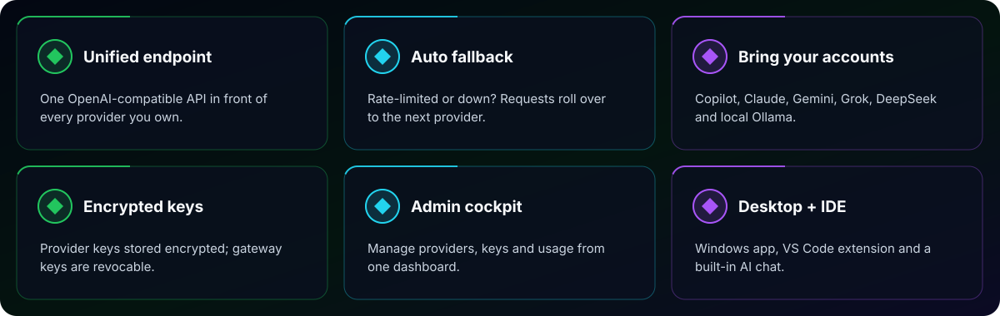
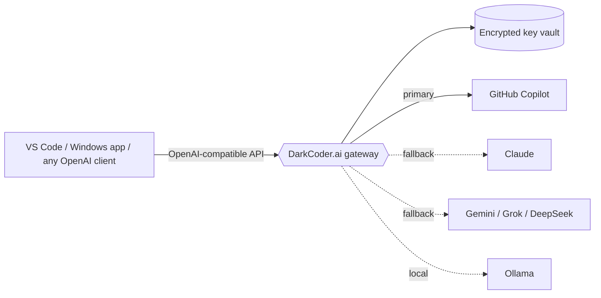

  
  
  
  

  <a href="#-overview"><b>Overview</b></a> &nbsp;•&nbsp;
  <a href="#-features"><b>Features</b></a> &nbsp;•&nbsp;
  <a href="#-tech-stack"><b>Tech</b></a> &nbsp;•&nbsp;
  <a href="#%EF%B8%8F-architecture"><b>Architecture</b></a> &nbsp;•&nbsp;
  <a href="#-source-code"><b>Source</b></a>

## ✨ Overview

**DarkCoder.ai** is a self-hosted AI gateway. Connect your own GitHub Copilot, Claude, Gemini, Grok, DeepSeek and local Ollama accounts and get **a single OpenAI-compatible endpoint** with automatic fallback between them.

It ships with encrypted key storage, revocable gateway keys, a built-in AI chat, an admin cockpit, a Windows app and a VS Code extension, so you never stop coding when one provider hits a limit.

  
   🖥️ Live at <a href="https://darkcoder.ai"><b>darkcoder.ai</b></a>

## 🚀 Features

  

| Feature | What it does |
|:--|:--|
| **Unified endpoint** | One OpenAI-compatible API in front of every provider you own. |
| **Auto fallback** | Rate-limited or down? Requests roll over to the next provider. |
| **Bring your accounts** | Copilot, Claude, Gemini, Grok, DeepSeek and local Ollama. |
| **Encrypted keys** | Provider keys stored encrypted; gateway keys are revocable. |
| **Admin cockpit** | Manage providers, keys and usage from one dashboard. |
| **Desktop + IDE** | Windows app, VS Code extension and a built-in AI chat. |

## 🧰 Tech Stack

## 🏗️ Architecture

## 🔒 Source Code

> [!NOTE]
> This is a **showcase repository**. The production source code of **DarkCoder.ai** is private and is not published here.
> Want a walkthrough, a similar build for your business, or licensing? **[Get in touch →](https://ajendra.info/contact)**

## 👤 Author

**Ajendra** — Full Stack Developer · Security Researcher · AI Engineer · Startup Advisor

⭐ If you like this project, star the repo — and check out my other work on <a href="https://ajendra.info/projects">ajendra.info/projects</a>.

